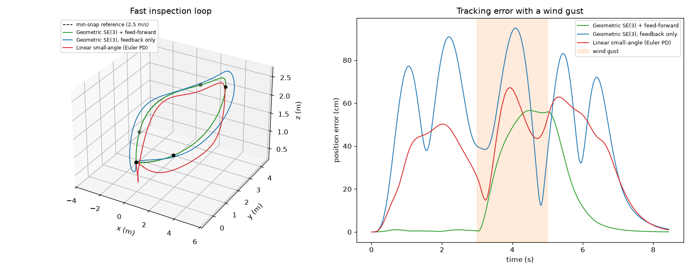

# Quadrotor: Minimum-Snap Trajectories and Geometric SE(3) Control



Full 6-DOF quadrotor simulation in Python (NumPy) with trajectory generation and control written from scratch:

- **Minimum-snap trajectories** (Mellinger & Kumar 2011): 7th-order polynomials through 3-D waypoints, solved exactly as an equality-constrained QP through its KKT system, with continuity up to the 6th derivative, plus **segment-time optimisation** of snap cost + time.
- **Geometric tracking controller on SE(3)** (Lee, Leok & McClamroch 2010): no Euler angles, so it works at large tilt, with **differential-flatness feed-forward** of body rates and angular acceleration, and the large-angle attitude error from Lee's follow-up work.
- **Baselines:** the same controller without feed-forward, and the common small-angle cascaded controller (Euler-angle PD with hover linearisation).
- **Dynamics:** rigid body on SO(3) with gyroscopic torque, X-configuration motor allocation, 0-6 N motor limits, 20 ms motor lag, wind gusts; 1 kHz physics, 500 Hz control.

## Results

<!-- python main.py
open quadrotor.png-->

## Run it

```bash
python3 -m venv .venv && source .venv/bin/activate
pip install -r requirements.txt
python tests.py      # quick self-checks
python main.py       # about 1 minute; prints the tables and saves quadrotor.png
```

## Files

- `minsnap.py`: minimum-snap QP, trajectory evaluation, time allocation and optimisation
- `quad.py`: SE(3) dynamics, motor model, geometric and Euler-PD controllers, flatness reference
- `main.py`: the experiments and the plot
- `tests.py`: self-checks (waypoints, continuity, SO(3) exponential, allocation, hover)

## Limitations

- No aerodynamic drag or rotor drag, and no blade-flapping effects; the wind is a pure force.
- No state estimation: the controller sees the true state (Project 15 covers estimation).
- The geometric controller has no integral term, so a sustained wind leaves a steady-state error.
